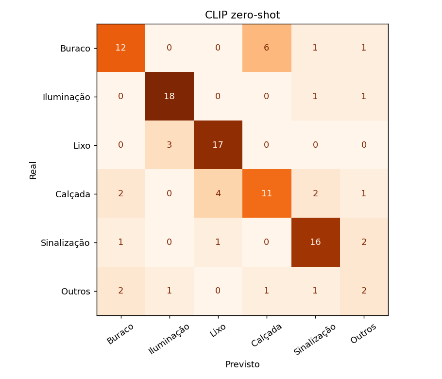
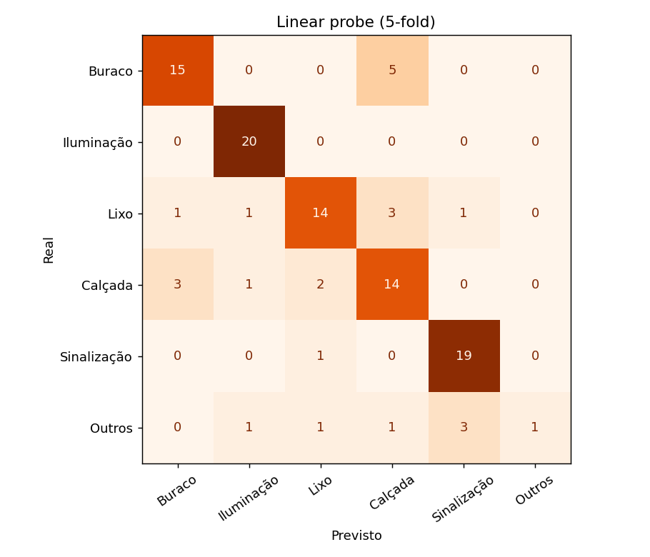

## Resultados - Visão computacional
Modelo: `openai/clip-vit-base-patch32` | 107 fotos de teste | por categoria: {'Buraco': 20, 'Iluminação': 20, 'Lixo': 20, 'Calçada': 20, 'Sinalização': 20, 'Outros': 7}

| Abordagem | Acurácia | F1 macro |
|---|---|---|
| CLIP zero-shot | 71.0% | 0.660 |
| Linear probe (5-fold) | 77.6% | 0.704 |

Limiar de confiança 0.5: 88.8% das fotos ficam acima dele, e nelas a acurácia é 76.8%.

| Categoria | Precisão | Recall | F1 |
|---|---|---|---|
| Buraco | 0.71 | 0.60 | 0.65 |
| Iluminação | 0.82 | 0.90 | 0.86 |
| Lixo | 0.77 | 0.85 | 0.81 |
| Calçada | 0.61 | 0.55 | 0.58 |
| Sinalização | 0.76 | 0.80 | 0.78 |
| Outros | 0.29 | 0.29 | 0.29 |

### Casos de falha (fotos noturnas)
| Arquivo | Esperado | Previsto | Confiança | Acima do limiar |
|---|---|---|---|---|
| fotos/falha_noturna/I-205_temporary_pothole_repair.jpg | Buraco | Buraco | 1.00 | sim |
| fotos/falha_noturna/Preparing_to_repair_a_pothole_on_I-205.jpg | Buraco | Buraco | 0.99 | sim |
| fotos/falha_noturna/Immature_Black-Crowned_Night_Heron_Huron_Wetland_Management_District_South_Dakot.jpg | Buraco | Lixo | 0.46 | não |
| fotos/falha_noturna/Red-winged_Blackbirds_on_the_horizon__22145152325_.jpg | Buraco | Outros | 0.46 | não |
